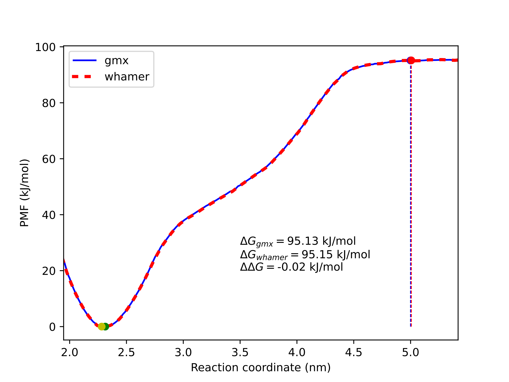

# whamer

Simple WHAM (Weighted Histogram Analysis Method) implementation in Python.

## Requirements

- **Python >= 3.10**
- NumPy >= 1.21.6
- SciPy >= 1.7.3

## Installation

Install directly from the GitHub repository (branch `v0.1.0`):

```bash
pip install git+https://github.com/TangumaAH/whamer@v0.1.0
```

## Package structure

| Module | Contents |
|---|---|
| `whamer.whamer` | `wham()` — core WHAM engine |
| `whamer.computer` | `profile_computer()` — PMF computation |
| `whamer.profile` | `Profile`, `Histo`, `HistoArray` — PMF profiles and histograms |
| `whamer.utils` | `FileManager`, `XVG` — xvg reading and writing |

## Usage as a library

```python
import whamer

# Full import
from whamer import wham, profile_computer, Profile, Histo, HistoArray, FileManager, XVG

# Compute a PMF from GROMACS files (log mode)
pmf, histo = whamer.profile_computer(
    pullx_files="pullx-files.dat",
    log_files="log-files.dat",
)

# Compute a PMF from plain-text init/k files
pmf, histo = whamer.profile_computer(
    pullx_files="pullx-files.dat",
    inits_file="inits.txt",
    k_values_file="k_values.txt",
)

# Access results
print(f"Delta G = {pmf.dg} kJ/mol")

# Use the core WHAM solver directly
import numpy as np
bin_centers, pmf_values = whamer.wham(
    trajectories=[...],   # list of 1D NumPy arrays
    centers=np.array([...]),
    force_constants=np.array([...]),
    temperature=300.0,
)
```

### Unit handling

By default, whamer assumes GROMACS units: **kJ/mol** for energy and **nm** for position.

If you use a different Boltzmann constant (`k_B`) in `profile_computer()`, pass the
corresponding unit labels to avoid a `UserWarning`:

```python
pmf, histo = whamer.profile_computer(
    pullx_files="pullx-files.dat",
    inits_file="inits.txt",
    k_values_file="k_values.txt",
    k_B=0.001987,            # kcal·mol⁻¹·K⁻¹
    energy_units="kcal/mol",
    position_units="Å",
)
```

## Command-line usage

After installation, the `compute_profile` command will be available.

### Mode 1 — GROMACS log files

```bash
compute_profile --log log-files.dat --pullx pullx-files.dat
```

### Mode 2 — Plain-text init/k files

```bash
compute_profile --inits inits.txt --k-values k_values.txt --pullx pullx-files.dat
```

`inits.txt` and `k_values.txt` contain numeric values separated by whitespace or newlines:

```
# inits.txt
0.0 0.1 0.2 0.3 ...
```

```
# k_values.txt
1000.0
1000.0
1000.0
...
```

The resulting profiles are completely equivalent to those produced by gmx wham.


### All CLI arguments

#### Input Options

| Argument | Description |
|---|---|
| `--log` | File listing `.log` paths (required unless `--inits` + `--k-values` are given) |
| `--inits` | File with initial positions (replaces `--log`) |
| `--k-values` | File with force constants (replaces `--log`) |
| `--pullx` | File listing `pullx.xvg` positions (**always required**) |

#### WHAM Options

| Argument | Default | Description |
|---|---|---|
| `--temperature` | `300.0` | Temperature in Kelvin |
| `--boltzmann` | `0.0083144621` | Boltzmann constant (default kJ·mol⁻¹·K⁻¹) |
| `--bins` | `100` | Number of histogram bins |
| `--maxiter` | `1000000` | Maximum WHAM iterations |
| `--tol` | `1e-07` | Convergence tolerance |

#### Unit Options

| Argument | Default | Description |
|---|---|---|
| `--E-units` | `kJ/mol` | Energy unit label for output XVG files |
| `--p-units` | `nm` | Position unit label for output XVG files |

> **Warning:** If `--boltzmann` is set to a non-default value without specifying
> `--E-units` and `--p-units`, whamer will emit a warning indicating that the
> output unit labels may be incorrect.

#### Profile Options

| Argument | Default | Description |
|---|---|---|
| `--profile` | `profile.xvg` | Output filename for the PMF profile |
| `--histo` | `histo.xvg` | Output filename for the histograms |
| `--histo_points` | `300` | Histogram interpolation points |


## References

References:
 - Kumar, et al. [J. Comp. Chem. 1992. 13(8), 1011-1021.](https://doi.org/10.1002/jcc.540130812)
 - Shell, et al. [Methods Based on Probability Distributions and Histograms.](https://doi.org/10.1007/978-3-540-38448-9_3)
